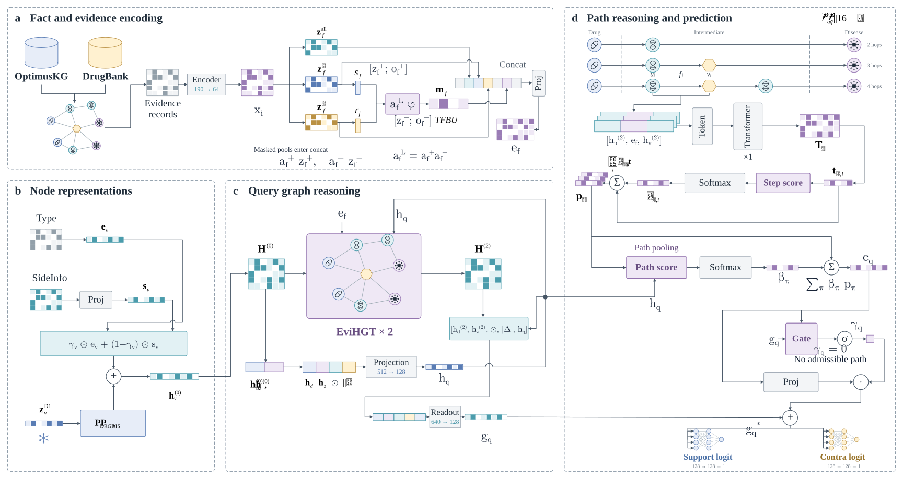

# EviHGT

EviHGT is an evidence-aware heterogeneous graph Transformer for drug–disease association ranking. Given a drug–disease query, it builds a subgraph from OptimusKG and structured DrugBank records, encodes the evidence and its provenance, and scores treatment support and contraindication-related associations in separate heads.

[Try the public checks on CPU](#try-the-public-checks) · [Inputs for the paper experiments](experiments/README.md#inputs-for-the-paper-experiments)

## Architecture



[Overview (SVG)](docs/figures/architecture.svg) · [Layer and path details (SVG)](docs/figures/architecture_details.svg) · [Editable Visio source](docs/figures/architecture.vsdx)

The full model combines provenance-aware evidence pooling, four-valued fact representations (True, False, Both and Unknown), query-conditioned graph layers, and bounded path encoding. It can use frozen chemical and disease-name embeddings as node features. When fact logic is available, the four direct logic transforms are averaged with equal weights. Learned fact masses enter the edge context. [Model equations and ablations](docs/model.md)

## Try the public checks

With Git and Python 3.11 or later, you can check the published five-fold comparison immediately. Run these commands in a terminal.

```sh
git clone https://github.com/YiwenPang/EviHGT.git
cd EviHGT
python experiments/audit/verify_r0.py
```

This uses only the Python standard library. Expect `Verified 55 method/fold/head entries across 10 common panels.` The check reads the published ledger and verifies that the methods share the recorded candidate counts and panel identity within each fold and output.

To try the model and the experiment code, create a virtual environment with `python -m venv .venv`. Activate it with `.\.venv\Scripts\Activate.ps1` in Windows PowerShell or `. .venv/bin/activate` in a POSIX shell. For a CPU installation on Windows or Linux, run the following from the repository root.

```sh
python -m pip install "torch>=2.6,<3" --index-url https://download.pytorch.org/whl/cpu
python -m pip install -r requirements-dev.txt
python experiments/run_checks.py
```

Once the dependencies are installed, the last command runs the public checks offline on CPU. It exercises the comparison metrics, Popularity baseline, ablations, HGTDR-contra scoring and checkpoints, and cold-start splits. It also trains EviHGT for three updates on a tiny synthetic graph and scores held-out candidates with both prediction heads. A successful run ends with `All public experiment checks passed.`

The paper's reported scores come from the original research inputs. Reproducing them requires the matching data, splits and study-specific artifacts. The [experiment guide](experiments/README.md#inputs-for-the-paper-experiments) lists what each study needs.

## Installation

Use Python 3.11 or later in a virtual environment. Install a [PyTorch build](https://pytorch.org/get-started/locally/) for your platform and device, then install the remaining dependencies.

```sh
python -m pip install -r requirements.txt
python check_environment.py --device cuda
```

The default configuration uses CUDA with BF16. For a CPU/FP32 run, use `configs/cpu.yaml` and check the environment with `--device cpu`. The observed dependency versions are listed in [requirements-observed.txt](requirements-observed.txt).

## Data and training

Download the two aggregate Parquet files from [OptimusKG release 2.0](https://dataverse.harvard.edu/dataset.xhtml?persistentId=doi:10.7910/DVN/IYNGEV&version=2.0), and obtain the full XML database and schema from [DrugBank](https://go.drugbank.com/releases/latest) with your own authorized account. Keep these filenames and paths relative to the repository root:

```text
data/
├── drugbank_all_full_database.xml
├── drugbank.xsd
└── cache/optimuskg/doi_10_7910_DVN_IYNGEV/2.0/recovery/aggregate/
    ├── nodes.parquet
    └── edges.parquet
```

Extract the DrugBank archive, then rename its full database XML to `drugbank_all_full_database.xml`. The [download guide](docs/data.md#download-and-place-the-source-databases) includes browser and command-line instructions, exact download links, and a read-only check: `python check_data.py`. DrugBank's academic downloads were temporarily paused when checked on 25 November 2026; access follows the provider's current terms and availability.

Training reads `data/processed/corpus/manifest.json` and the files listed in it. This release imports a prepared corpus with `prepare_data.py` or exports a completed research corpus with `export_data.py`; the raw-to-training preprocessing entry point is not yet published. Placing the raw downloads above does not create that corpus. Follow [the preparation commands](docs/data.md#supported-preparation-routes) for the supported inputs. All source records and derived data stay in the Git-ignored `data/` directory.

### Train the full model

```sh
python main.py
```

Training checks the inputs first, then runs the three-cycle plan in the prepared corpus. The default settings are in `configs/default.yaml`. Training writes logs, development metrics and checkpoints to `outputs/`. See the [reproducibility guide](docs/reproducibility.md) for output files, checkpoints and evaluation scope.

### Check the inputs before training (optional)

```sh
python main.py --mode validate
```

Use this command after preparing or changing the corpus. It checks the configuration and loads the prepared inputs, writes a validation report to `outputs/`, and exits before initializing the model.

For CPU, add `--config configs/cpu.yaml` to either command. In PyCharm, select the same interpreter and set the desired arguments on the `main.py` run configuration.

Run specific ablations by name, for example:

```sh
python ablation.py --variants NO_D1 NO_PATH
```

## Development results

Browse the [baseline comparisons](experiments/comparisons/), [ablations](experiments/ablations/) and [cold-start experiments](experiments/cold_start/). The [experiment index](experiments/) also links to the HGTDR contraindication study and the fold-by-fold audit.

The table summarizes five inner development folds of repeat R0. Metrics are averaged over eligible folds within each disease, then over 1,697 support diseases or 314 contraindication diseases. HGTDR-adapted and HGTDR-adapted-contra are separate single-output models selected on their respective development panels. EviHGT reports both outputs from one model at the fixed three-cycle endpoint.

As in the manuscript, **bold** marks the best value in each metric column; <ins><em>italic underlining</em></ins> identifies EviHGT values.

| Method | Support AUC | Support AP | Support NDCG@10 | Contra AUC | Contra AP | Contra NDCG@10 |
| --- | ---: | ---: | ---: | ---: | ---: | ---: |
| EviHGT | <ins><em>0.898440</em></ins> | <ins><em>0.873292</em></ins> | <ins><em>0.911893</em></ins> | <ins><em>0.922813</em></ins> | <ins><em>0.895974</em></ins> | <ins><em>0.927292</em></ins> |
| HGT-D1 | 0.864699 | 0.835220 | 0.883860 | 0.927014 | 0.897898 | 0.928273 |
| PairMLP-D1 | 0.858382 | 0.823047 | 0.885701 | 0.901586 | 0.878157 | 0.913876 |
| HGTDR-adapted | **0.922917** | **0.901453** | **0.930877** | — | — | — |
| HGTDR-adapted-contra | — | — | — | **0.964060** | **0.942237** | **0.959349** |
| TxGNN-adapted | 0.813216 | 0.778118 | 0.848928 | 0.876748 | 0.837941 | 0.884425 |
| Popularity | 0.828239 | 0.789221 | 0.864763 | 0.932036 | 0.893040 | 0.934880 |

In the input- and budget-matched comparison, EviHGT raises support AP by 3.81 percentage points over HGT-D1 and 5.02 over PairMLP-D1, while producing support and contraindication rankings from one model. These differences measure the full EviHGT model under matched conditions. [Experiment figures and evaluation protocol](docs/experiments.md)

## Cold-disease results

On a strict disease holdout, EviHGT increased treatment-support AP from 0.5233 to 0.5703 and NDCG@10 from 0.6025 to 0.6489 relative to HGTDR-adapted. HGTDR-adapted-contra achieved contraindication AP of 0.7078, against 0.6690 for EviHGT. Both models scored the same test candidates. [Full metrics and paired intervals](docs/experiments.md#cold-disease-comparison) · [Code and input requirements](experiments/cold_start/hgtdr/)

## Tests

To run just the portable model and data tests after installing the test dependencies, use `python -m pytest tests -q --basetemp outputs/pytest`. The [public checks](#try-the-public-checks) also exercise the study-specific code.

[CI workflow](.github/workflows/tests.yml) · [Python API](docs/python_api.md) · [Troubleshooting](docs/troubleshooting.md) · [Model card](docs/model_card.md) · [Contributing](CONTRIBUTING.md) · [Citation](CITATION.md)
