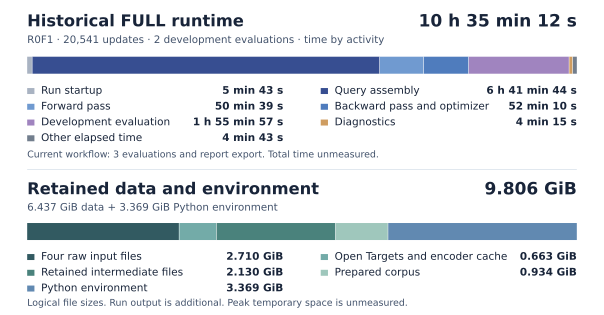
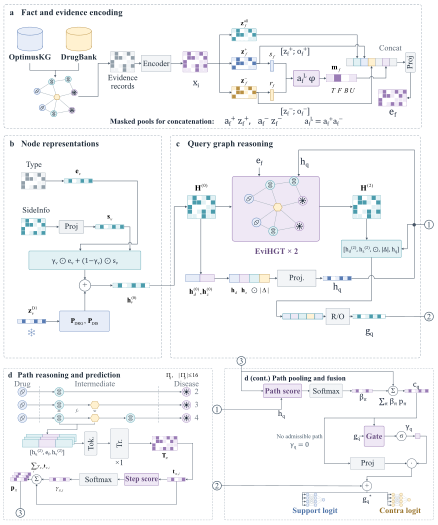

# EviHGT

[中文指南](README.zh-CN.md) · [Installation](#installation) · [Run the full model](#run-the-full-model) · [Run the paper experiments](#run-the-paper-experiments) · [View the results](#view-the-results) · [Development results](#development-results) · [Cold-disease results](#cold-disease-results)

EviHGT is an evidence-aware heterogeneous graph Transformer for drug–disease association ranking. Given a drug–disease query, it builds a subgraph from OptimusKG and structured DrugBank records, encodes the evidence and its provenance, and scores treatment support and contraindication-related associations in separate heads.

Use `main.py` to prepare the raw databases, train the FULL model for three cycles on the default R0F1 fold, evaluate both development outputs, and save drug rankings and path explanations with an HTML report. Follow the steps below from the repository root.

## Installation

Install Git and Python 3.11 or later, then create a virtual environment:

```sh
git clone https://github.com/YiwenPang/EviHGT.git
cd EviHGT
python -m venv .venv
```

Activate it in Windows PowerShell 7:

```powershell
.\.venv\Scripts\Activate.ps1
```

On Linux, use:

```sh
. .venv/bin/activate
```

For an NVIDIA GPU with a driver compatible with CUDA 12.8, install the CUDA build and workflow dependencies:

```sh
python -m pip install --upgrade pip
python -m pip install "torch>=2.7,<3" --index-url https://download.pytorch.org/whl/cu128
python -m pip install -r requirements-preprocess.txt
python check_environment.py --device cuda
```

Use the [official PyTorch installer](https://pytorch.org/get-started/locally/) to select another build for your platform and driver. The default run uses CUDA with BF16; the environment check must report `READY`. The observed package versions are recorded in [requirements-observed.txt](requirements-observed.txt).

`requirements-preprocess.txt` includes XML parsing, RDKit and the frozen encoder libraries as well as training dependencies. An existing portable corpus needs `requirements.txt`. For a CPU-only installation, replace the PyTorch install command with:

```sh
python -m pip install "torch>=2.6,<3" --index-url https://download.pytorch.org/whl/cpu
```

Check that environment with `python check_environment.py --device cpu`.

## Download and place the four source files

| File | Download and preparation |
| --- | --- |
| `nodes.parquet` | Download the aggregate file from [OptimusKG release 2.0](https://dataverse.harvard.edu/dataset.xhtml?persistentId=doi:10.7910/DVN/IYNGEV&version=2.0). |
| `edges.parquet` | Download the aggregate file from the same release. Select the two aggregate files rather than the per-type files under `nodes/` and `edges/`. |
| `drugbank_all_full_database.xml` | Obtain **All drugs / full database XML** through your authorized [DrugBank account](https://go.drugbank.com/releases/latest). Extract the archive and rename the full XML to this filename. The parser requires root attribute `version="5.1"`. |
| `drugbank.xsd` | Save the linked **Schema Definition** from the same DrugBank release as this filename. |

Place the files at these paths:

```text
data/
├── drugbank_all_full_database.xml
├── drugbank.xsd
└── cache/optimuskg/doi_10_7910_DVN_IYNGEV/2.0/recovery/aggregate/
    ├── nodes.parquet
    └── edges.parquet
```

The study's local DrugBank XML records `version="5.1"` and `exported-on="2026-04-23"`; the header does not identify its patch release. Keep your export's release information and checksums. As checked on 26 November 2026, DrugBank's public page reports a pause in academic downloads. Use an existing authorized full export or obtain access through the provider; the repository does not distribute DrugBank records. [Download details and direct OptimusKG links](docs/data.md#download-and-place-the-source-databases)

Check the filenames, OptimusKG hashes and DrugBank XML/XSD headers:

```sh
python check_data.py
```

The check reads the source files without changing them. Keep raw and derived data in the Git-ignored `data/` directory. Missing pinned Open Targets 25.06 and ChemBERTa/BioBERT files are downloaded into `data/cache/` during preparation. Database parsing and encoder inference run locally.

<a id="try-the-public-checks"></a>

## Optional CPU smoke test

```sh
python main.py --smoke
```

This runs the FULL model for three optimizer updates on a tiny synthetic corpus, then produces development metrics, rankings, path explanations and an HTML report under `outputs/smoke/`. It uses CPU and needs neither the four databases nor network access. Its output is marked `SYNTHETIC_TEST_ONLY`; it checks the software workflow, not reconstruction of the original databases or biomedical performance. You can run it before downloading data.

## Tests

The smoke command above checks the main workflow. For the complete software test suite, install the test dependencies and run:

```sh
python -m pip install -r requirements-dev.txt
python -m pytest tests -q --basetemp outputs/pytest
```

[CI workflow](.github/workflows/tests.yml) · [Python API](docs/python_api.md) · [Model card](docs/model_card.md) · [Contributing](CONTRIBUTING.md) · [Citation](CITATION.md)

## Run the full model

```sh
python main.py
```

On the first run, `main.py` prepares `data/processed/corpus/manifest.json` from the four raw files, validates the corpus, and continues through three training cycles. It evaluates support and contra on the development panels after each cycle, then writes final rankings, explanations and the report. Later invocations validate the existing corpus and start a new training run.

The default configuration files are:

| Configuration | Controls |
| --- | --- |
| [configs/raw.yaml](configs/raw.yaml) | Source paths, preparation stages, caches, feature device and feature batch size. |
| [configs/default.yaml](configs/default.yaml) | Corpus path, output directory, CUDA/BF16 training and optimizer settings. |
| [configs/report.yaml](configs/report.yaml) | Output limits: `explanation_queries: 10`, `paths_per_query: 5`, `ranking_top_k: 10`. |

Use `--raw-config`, `--config` or `--report-config` to select another YAML file. Report limits control saved output and explanation work; they do not change training samples, optimizer updates or the development candidate panels.

The default command runs FULL on one fold, R0F1 (`R0` is repeat 0; `F1` is fold 1). All three training cycles belong to that same fold. The raw recipe reconstructs its original memberships and fixed sampling plan.

For CPU training, add `--config configs/cpu.yaml`. If raw preparation must also use CPU, copy `configs/raw.yaml`, set `feature_device: cpu`, and pass that copy with `--raw-config`. In PyCharm, select the same interpreter and run `main.py` from the repository root.

### Environment and measured resources

The reference workstation and its recorded software environment are:

| Component | Configuration |
| --- | --- |
| OS | Windows 11 Pro for Workstations, 64-bit |
| CPU | Intel Core Ultra 9 285K, 24 cores / 24 threads |
| Installed RAM | 64GiB |
| GPU | NVIDIA GeForce RTX 5080, 16GB |
| Python / PyTorch | Python 3.14.6 / PyTorch 2.13.0+cu132 |
| CUDA build / training precision | CUDA 13.2 / BF16 |

These software versions come from workstation snapshots; the original training run did not save its own package snapshot. The installation example above uses a CUDA 12.8 build; choose a build supported by your driver. [Recorded packages](requirements-observed.txt)

| Measurement | Recorded value and scope |
| --- | --- |
| Historical single-fold FULL run: R0F1 | **10h 35m 12s** wall time: three training cycles, 20,541 optimizer updates, two development evaluations and fixed diagnostics. Starts with an existing corpus. |
| Training updates within that run | 8h 24m 33s, including query assembly, forward passes, backpropagation and optimizer steps. |
| Raw-data preparation | 11m 52s in a separate completed preparation run, with auxiliary downloads already cached. |
| Process RAM | **7.21GiB**, maximum RSS recorded after a training update. |
| GPU memory | **3.02GiB**, maximum PyTorch CUDA reserved memory recorded after a training update. |
| Retained data and caches | **6.437GiB**: four raw files, auxiliary caches, retained intermediate files and the prepared corpus with frozen features. |
| Python environment | 3.369GiB for the measured `.venv`, bringing data plus this environment to **9.806GiB**. |
| Historical R0F1 training outputs | 1.379GiB, including 23 checkpoints; the final checkpoint is 58.92MiB. |

The current `main.py` evaluates after each of the three cycles and also exports rankings, explanations and an HTML report. Its complete wall time has not yet been measured. RAM and GPU figures are maxima among logged samples; full-workflow and instantaneous peaks were not recorded. Disk figures are retained logical file sizes, with system Python, drivers and download staging excluded. Allow additional space for temporary files and new outputs. The current workflow maintains one rolling `checkpoints/latest.pt`; its final output size has not yet been measured.



[Resource measurements, scope and source checksums](docs/resource_reference.json)

### Single-fold and multi-fold runtime

The **10h 35m 12s** reference covers one historical R0F1 FULL run. A multi-fold experiment trains a separate model for each fold, so its elapsed time accumulates across runs.

| Historical FULL scope | Recorded duration | Period (UTC+8) |
| --- | --- | --- |
| One fold: R0F1, three training cycles | **10h 35m 12s** | Original single-fold worker timing. |
| One repeat: all five R2 folds | **91.56h**, about **3d 19h 34m** | 4–8 November 2026. |
| Queue of 12 additional folds | **205.31h**, about **8d 13h 19m** | 30 October–8 November 2026. |

The R2 interval runs from the first fold's training-log creation to the final fold's completion receipt. The 12-fold interval runs from worker startup to the last completion receipt, including initialization and gaps between folds. Both include development evaluation and finalization. These 12 folds were newly trained; three other folds, including R0F1, reused earlier results and are outside this interval. These are historical FULL timings; the complete wall time of the current `--experiment comparisons` and `--experiment all` workflows has not yet been measured. [Timing definitions and source checksums](docs/resource_reference.json)

## Run the paper experiments

Use the same four source files from the download section. Each command prepares its graphs and evaluation candidates, runs the selected jobs, and writes an experiment report. The `requirements-preprocess.txt` installation includes `filelock` for experiment runs.

```sh
python main.py --experiment ablations
python main.py --experiment losses
python main.py --experiment comparisons
python main.py --experiment cold
python main.py --experiment all
```

`comparisons` runs FULL and six baselines across the five R0 folds. `all` runs the four suites in sequence. To check a smaller setup, use this CPU smoke test with synthetic data.

```sh
python main.py --experiment comparisons --smoke --methods FULL TRAIN_VISIBLE_POPULARITY
```

For a full comparison, install the matched controls and native adapters in their specified environments. The cold suite includes two HGTDR models on the disease holdout. Add `--skip-cold-hgtdr` to run the EviHGT cold cases on their own. [Native installation](experiments/workflow/native_sources/README.md)

Experiment reports go to `outputs/experiments/<timestamp>_<experiment>/report.html` by default. That directory also contains `summary.json`, `metrics.csv`, and `disease_metrics.csv`. Use `--run-dir outputs/NAME` to name a run and `--resume` with the same directory and selections to continue interrupted work. [Default folds, selection flags and recovery](experiments/#run-from-the-source-databases)

## View the results

Open `outputs/<run>/report.html` in a browser after the command finishes. The console prints the actual run path. The workflow is complete when it exits successfully and that run's `completion.json` records `status: COMPLETE` after report generation.

| Output under `outputs/<run>/` | Content |
| --- | --- |
| `report.html` | Local HTML overview of metrics, rankings and selected explanations. |
| `summary.json` | Machine-readable run and report summary. |
| `rankings/support.csv`, `rankings/contra.csv` | Drug rankings within each disease's development candidate pool. |
| `rankings/support_top10.csv`, `rankings/contra_top10.csv` | Top-K extracts for each disease; the filename follows `ranking_top_k`. |
| `explanations/index.json`, `explanations/queries/*.json` | Selected queries, bounded biological paths and their recorded model evidence. |
| `evaluation/step_N/metrics.json` | Support/contra metrics at logical update `N`. |
| `evaluation/step_N/*.parquet` | Scored development candidates with both head logits. |
| `checkpoints/latest.pt` | Latest saved model, optimizer and RNG state for training recovery. |
| `configuration.json`, `environment.json`, `model.json` | Run settings, software/hardware environment and model metadata. |
| `logs/events.jsonl`, `logs/errors.log` | Structured events and the full traceback if a stage fails. |

Support ranks the indication P and U candidates; contra ranks the contraindication P candidates with the same development U pool. U means unobserved, not a verified negative. The full CSV files retain every supplied candidate; `ranking_top_k` controls the separate Top-K extracts. Path explanations describe the model's bounded graph reasoning and source evidence; they do not establish a causal mechanism.

Preparation reports are separate, under `outputs/preparation/<attempt-id>/`. Derived corpus and stage files stay under `data/`. See [reproducibility and output details](docs/reproducibility.md).

## Resume, evaluate or prepare offline

Resume from a trusted local checkpoint using the same training configuration and corpus:

```sh
python main.py --checkpoint outputs/RUN_ID/checkpoints/latest.pt
```

To regenerate development metrics, rankings, explanations and the report from a checkpoint without optimizer updates:

```sh
python main.py --mode evaluate --checkpoint outputs/RUN_ID/checkpoints/latest.pt
```

Each invocation writes a new run directory. Replace `RUN_ID` with the actual previous directory. Add the original `--config` when it differs from the default, and use `--report-config` to change the output limits. An evaluation or already-complete resume records the source checkpoint instead of copying it into the new directory.

To prepare the corpus without training, or validate an existing corpus:

```sh
python main.py --mode prepare
python main.py --mode validate
```

To run with public auxiliary files already cached:

```sh
python main.py --offline
```

Offline preparation requires the exact pinned Open Targets and encoder files; it reports missing resources and stops. Rerun interrupted preparation with the same configurations to reuse verified completed stages. Changed raw files, build code, bound packages or feature settings require new stage and corpus destinations. [Preparation and recovery](docs/data.md#supported-preparation-routes) · [Troubleshooting](docs/troubleshooting.md)

## Architecture



[Figure 1 (SVG)](docs/figures/manuscript/figure01-en.svg) · [Figure 1 (PDF)](docs/figures/manuscript/figure01-en.pdf) · [Figure 2 (SVG)](docs/figures/manuscript/figure02-en.svg) · [Figure 2 (PDF)](docs/figures/manuscript/figure02-en.pdf) · [Editable Visio for Figures 1 and 2](docs/figures/manuscript/architecture-en.vsdx)

The 27 November 2026 figure set includes the manuscript SVGs, PNG previews, single-page figure PDFs and editable Visio diagrams. [Manuscript Figures 1–11](docs/manuscript_figures.md)

The full model combines provenance-aware evidence pooling, four-valued fact representations (True, False, Both and Unknown), query-conditioned graph layers, and bounded path encoding. It can use frozen chemical and disease-name embeddings as node features. When fact logic is available, the four direct logic transforms are averaged with equal weights. Learned fact masses enter the edge context. [Model equations and ablations](docs/model.md)

<a id="development-results"></a>

## Recorded development results

The table summarizes five inner development folds of repeat R0 from the original research runs. Metrics are averaged over eligible folds within each disease, then over 1,697 support diseases or 314 contraindication diseases. HGTDR-adapted and HGTDR-adapted-contra are separate single-output models selected on their respective development panels. EviHGT reports both outputs from one model at the fixed three-cycle endpoint.

As in the manuscript, **bold** marks the best value in each metric column; <ins><em>italic underlining</em></ins> identifies EviHGT values.

| Method | Support AUC | Support AP | Support NDCG@10 | Contra AUC | Contra AP | Contra NDCG@10 |
| --- | ---: | ---: | ---: | ---: | ---: | ---: |
| EviHGT | <ins><em>0.898440</em></ins> | <ins><em>0.873292</em></ins> | <ins><em>0.911893</em></ins> | <ins><em>0.922813</em></ins> | <ins><em>0.895974</em></ins> | <ins><em>0.927292</em></ins> |
| HGT-D1 | 0.864699 | 0.835220 | 0.883860 | 0.927014 | 0.897898 | 0.928273 |
| PairMLP-D1 | 0.858382 | 0.823047 | 0.885701 | 0.901586 | 0.878157 | 0.913876 |
| HGTDR-adapted | **0.922917** | **0.901453** | **0.930877** | — | — | — |
| HGTDR-adapted-contra | — | — | — | **0.964060** | **0.942237** | **0.959349** |
| TxGNN-adapted | 0.813216 | 0.778118 | 0.848928 | 0.876748 | 0.837941 | 0.884425 |
| Popularity | 0.828239 | 0.789221 | 0.864763 | 0.932036 | 0.893040 | 0.934880 |

In the input- and budget-matched comparison, EviHGT raises support AP by 3.81 percentage points over HGT-D1 and 5.02 over PairMLP-D1, while producing support and contraindication rankings from one model. These differences measure the full EviHGT model under matched conditions. [Experiment figures and evaluation protocol](docs/experiments.md)

## Cold-disease results

On the strict disease-holdout test, EviHGT outperforms HGTDR-adapted on all three reported treatment-support ranking metrics, with **AP increasing by 4.70 percentage points and NDCG@10 by 4.64 points**. The evaluation graph excludes all facts incident to held-out diseases, and both methods rank the same test candidates. Scores are macro-averaged over 196 evaluable diseases.

| Method | ROC-AUC ↑ | AP ↑ | NDCG@10 ↑ |
| --- | ---: | ---: | ---: |
| EviHGT | <ins><em><strong>0.8705</strong></em></ins> | <ins><em><strong>0.5703</strong></em></ins> | <ins><em><strong>0.6489</strong></em></ins> |
| HGTDR-adapted | 0.8503 | 0.5233 | 0.6025 |
| EviHGT gain (percentage points) | **+2.02** | **+4.70** | **+4.64** |
| 95% paired interval for gain (points) | [0.03, 4.00] | [1.27, 8.24] | [1.15, 8.25] |

The 95% intervals use 10,000 paired disease bootstrap draws and describe variation across diseases conditional on this split and these fitted models. [Full support/contra results and comparison settings](docs/experiments.md#cold-disease-comparison) · [Final result data](experiments/cold_start/hgtdr/results.json)
