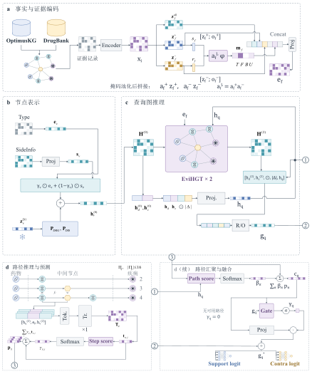

# EviHGT

[English](README.md) · [安装环境](#安装环境) · [运行完整主模型](#运行完整主模型) · [运行论文实验](#运行论文实验) · [查看结果](#查看结果)

EviHGT 是用于药物–疾病关联排序的证据感知异构图 Transformer。针对一个药物–疾病查询，模型从 OptimusKG 和 DrugBank 结构化记录中提取子图，编码证据及其来源，并通过两个独立预测头分别给出治疗支持和禁忌相关关联分数。

使用 `main.py` 即可完成原始数据准备、FULL 主模型三个周期的训练、双任务开发集评估，以及药物排名、路径解释和 HTML 报告输出。以下命令均在仓库根目录执行。

<a id="installation"></a>

## 安装环境

安装 Git 和 Python 3.11 或更高版本，克隆仓库并创建虚拟环境：

```sh
git clone https://github.com/YiwenPang/EviHGT.git
cd EviHGT
python -m venv .venv
```

在 Windows PowerShell 7 中激活环境：

```powershell
.\.venv\Scripts\Activate.ps1
```

Linux 使用：

```sh
. .venv/bin/activate
```

如果使用 NVIDIA GPU，且驱动支持 CUDA 12.8，可安装以下 CUDA 版 PyTorch 和工作流依赖：

```sh
python -m pip install --upgrade pip
python -m pip install "torch>=2.7,<3" --index-url https://download.pytorch.org/whl/cu128
python -m pip install -r requirements-preprocess.txt
python check_environment.py --device cuda
```

其他平台或驱动请通过 [PyTorch 官方安装页](https://pytorch.org/get-started/locally/)选择对应版本。默认训练使用 CUDA 和 BF16，环境检查应显示 `READY`。已记录的运行环境版本见 [requirements-observed.txt](requirements-observed.txt)。

`requirements-preprocess.txt` 包含训练依赖、XML 解析、RDKit 和冻结编码器推理库。已有完整便携语料时，安装 `requirements.txt` 即可。仅使用 CPU 时，将 PyTorch 安装命令替换为：

```sh
python -m pip install "torch>=2.6,<3" --index-url https://download.pytorch.org/whl/cpu
```

该环境使用 `python check_environment.py --device cpu` 检查。

<a id="download-and-place-the-four-source-files"></a>

## 下载并放置四个原始文件

| 文件 | 下载与处理方法 |
| --- | --- |
| `nodes.parquet` | 从 [OptimusKG 2.0](https://dataverse.harvard.edu/dataset.xhtml?persistentId=doi:10.7910/DVN/IYNGEV&version=2.0) 下载 aggregate 节点文件。 |
| `edges.parquet` | 从同一版本下载 aggregate 边文件。选择这两个聚合文件，不要用 `nodes/`、`edges/` 下按类型拆分的文件替代。 |
| `drugbank_all_full_database.xml` | 使用本人获授权的 [DrugBank 账户](https://go.drugbank.com/releases/latest)获取 **All drugs / full database XML**，解压后将完整 XML 重命名为此文件名。解析器要求 XML 根节点属性为 `version="5.1"`。 |
| `drugbank.xsd` | 将同一 DrugBank 版本链接的 **Schema Definition** 保存为此文件名。 |

放置路径如下：

```text
data/
├── drugbank_all_full_database.xml
├── drugbank.xsd
└── cache/optimuskg/doi_10_7910_DVN_IYNGEV/2.0/recovery/aggregate/
    ├── nodes.parquet
    └── edges.parquet
```

本研究使用的 DrugBank XML 头部记录为 `version="5.1"`、`exported-on="2026-04-23"`；该头部不能确定补丁版本。请保留自己导出文件的版本信息和校验值。2026 年 11 月 26 日核查时，DrugBank 官方页面提示学术下载暂停；可使用已有的获授权完整导出，或通过提供方获取访问权限。仓库不提供 DrugBank 数据文件。[下载细节与 OptimusKG 直链](docs/data.md#download-and-place-the-source-databases)

检查文件名、OptimusKG 哈希和 DrugBank XML/XSD 头部：

```sh
python check_data.py
```

该命令只读原始文件。原始数据和派生数据保存在已被 Git 忽略的 `data/` 下。准备阶段会将缺失的固定版本 Open Targets 25.06、ChemBERTa 和 BioBERT 文件下载至 `data/cache/`；数据库解析和编码器推理均在本机执行。

<a id="try-the-public-checks"></a>
<a id="optional-cpu-smoke-test"></a>

## 可选的 CPU 快速自检

```sh
python main.py --smoke
```

该命令使用微型合成语料，在 CPU 上完成 FULL 模型三次优化器更新，随后在 `outputs/smoke/` 下生成开发集指标、排名、路径解释和 HTML 报告。它无需四个真实数据库文件，也无需网络，可以在下载数据前运行。输出标记为 `SYNTHETIC_TEST_ONLY`，用于检查软件流程；它不代表原始数据库重建或生物医学实验结果。

<a id="run-the-full-model"></a>

## 运行完整主模型

```sh
python main.py
```

首次运行时，`main.py` 根据四个原始文件生成 `data/processed/corpus/manifest.json`，完成语料校验后继续训练三个周期。默认在每个周期结束后分别评估 support 和 contra，最后输出排名、解释和报告。之后再次运行，会校验已有语料并开始一次新的训练。

默认使用以下配置：

| 配置文件 | 控制内容 |
| --- | --- |
| [configs/raw.yaml](configs/raw.yaml) | 原始文件路径、准备阶段目录、缓存、特征推理设备和批量大小。 |
| [configs/default.yaml](configs/default.yaml) | 语料路径、输出目录、CUDA/BF16 训练及优化器设置。 |
| [configs/report.yaml](configs/report.yaml) | 输出数量：`explanation_queries: 10`、`paths_per_query: 5`、`ranking_top_k: 10`。 |

通过 `--raw-config`、`--config` 或 `--report-config` 指定其他 YAML。报告配置控制保存的输出数量和解释计算量，不改变训练样本、优化器更新或开发集候选面板。

该命令按原始数据流程重建 R0F1 成员划分和固定采样计划，供 FULL 主模型训练使用。

需要 CPU 训练时，添加 `--config configs/cpu.yaml`。如果特征准备也使用 CPU，请复制 `configs/raw.yaml`，将 `feature_device` 设为 `cpu`，并用 `--raw-config` 指定该文件。在 PyCharm 中选择同一解释器，将工作目录设为仓库根目录后运行 `main.py`。

<a id="run-the-paper-experiments"></a>

## 运行论文实验

沿用上文列出的四个原始文件。每条命令按所选实验准备图和候选集、运行各项任务并生成报告。安装 `requirements-preprocess.txt` 时会一并安装实验调度所需的 `filelock`。

```sh
python main.py --experiment ablations
python main.py --experiment losses
python main.py --experiment comparisons
python main.py --experiment cold
python main.py --experiment all
```

`all` 依次运行四组实验。下面的命令用 CPU 和合成数据检查 FULL 与 Popularity 的对比流程。

```sh
python main.py --experiment comparisons --smoke --methods FULL TRAIN_VISIBLE_POPULARITY
```

完整对比需要安装匹配对照和原生基线的依赖。冷启动还包含疾病留出场景下的两个 HGTDR 模型。只运行 EviHGT 的冷启动场景时，添加 `--skip-cold-hgtdr`。[原生模型安装说明](experiments/workflow/native_sources/README.zh-CN.md)

实验报告默认保存到 `outputs/experiments/<timestamp>_<experiment>/report.html`，同目录下还有 `summary.json`、`metrics.csv` 和 `disease_metrics.csv`。可用 `--run-dir outputs/NAME` 指定目录。中断后使用同一目录、原有选项和 `--resume` 继续运行。[默认折、筛选参数与恢复说明](experiments/README.zh-CN.md#run-from-the-source-databases)

<a id="view-the-results"></a>

## 查看结果

命令完成后，在浏览器中打开 `outputs/<run>/report.html`；控制台会打印实际运行目录。程序成功退出，且该目录的 `completion.json` 在报告生成后记录 `status: COMPLETE`，表示整条流程已完成。

| `outputs/<run>/` 下的文件 | 内容 |
| --- | --- |
| `report.html` | 本地 HTML 报告，包含指标、排名和选定查询的解释。 |
| `summary.json` | 可供程序读取的运行及报告摘要。 |
| `rankings/support.csv`、`rankings/contra.csv` | 每个疾病在其开发集候选池内的药物排名。 |
| `rankings/support_top10.csv`、`rankings/contra_top10.csv` | 每个疾病的 Top-K 摘录，文件名随 `ranking_top_k` 变化。 |
| `explanations/index.json`、`explanations/queries/*.json` | 选定查询、有界生物学路径及模型记录的证据信息。 |
| `evaluation/step_N/metrics.json` | 第 `N` 次逻辑更新后的 support/contra 指标。 |
| `evaluation/step_N/*.parquet` | 开发集候选及两个预测头的 logit。 |
| `checkpoints/latest.pt` | 最近一次保存的模型、优化器和随机数状态，供训练恢复使用。 |
| `configuration.json`、`environment.json`、`model.json` | 运行配置、软硬件环境和模型元数据。 |
| `logs/events.jsonl`、`logs/errors.log` | 结构化事件；失败时的完整异常堆栈。 |

Support 排序使用适应证 P 和 U 候选；contra 使用禁忌证 P 和同一开发集 U 池。U 表示未观测候选，不是已验证的负例。完整 CSV 保留每个疾病已提供的全部候选，`ranking_top_k` 控制单独保存的 Top-K 摘录。路径解释呈现模型在有界子图中的推理路径及来源证据，不能据此认定因果机制。

数据准备报告单独保存在 `outputs/preparation/<attempt-id>/`；派生语料和准备阶段文件保存在 `data/`。更多输出说明见[复现指南](docs/reproducibility.md)。

<a id="resume-evaluate-or-prepare-offline"></a>

## 恢复训练、重新评估和离线准备

使用相同训练配置和语料，从可信的本地 checkpoint 恢复：

```sh
python main.py --checkpoint outputs/RUN_ID/checkpoints/latest.pt
```

若要根据 checkpoint 重新生成开发集指标、排名、解释和报告，不进行优化器更新：

```sh
python main.py --mode evaluate --checkpoint outputs/RUN_ID/checkpoints/latest.pt
```

每次调用都会创建新的运行目录。请将 `RUN_ID` 替换为实际目录名；原训练使用非默认配置时，添加对应的 `--config`。可以通过 `--report-config` 调整输出数量。重新评估或从已完成的 checkpoint 恢复时，新报告记录原 checkpoint 路径，不会复制一份权重。

只准备语料，或校验已有语料：

```sh
python main.py --mode prepare
python main.py --mode validate
```

公共辅助资源已缓存时，可离线运行：

```sh
python main.py --offline
```

离线准备要求缓存中具备指定版本的 Open Targets 和编码器文件；缺失时会报错并停止。准备中断后，使用相同配置重试即可复用已校验的完成阶段。原始文件、构建代码、绑定的软件包或特征设置变化时，应使用新的阶段目录和语料目录。[数据准备与恢复](docs/data.md#supported-preparation-routes) · [故障排查](docs/troubleshooting.md)

<a id="architecture"></a>

## 模型架构



[图 1 SVG](docs/figures/manuscript/figure01-zh.svg) · [图 1 PDF](docs/figures/manuscript/figure01-zh.pdf) · [图 2 SVG](docs/figures/manuscript/figure02-zh.svg) · [图 2 PDF](docs/figures/manuscript/figure02-zh.pdf) · [图 1 和图 2 的可编辑 Visio 源图](docs/figures/manuscript/architecture-zh.vsdx)

2026 年 11 月 27 日版图件提供稿件所用 SVG、PNG 预览、单页图件 PDF 及可编辑的 Visio 图源。 [论文图 1–11](docs/manuscript_figures.zh-CN.md)

完整模型结合来源感知的证据聚合、True/False/Both/Unknown 四值事实表示、查询条件化图层和有界路径编码，并使用冻结的化学结构与疾病名称向量作为节点特征。事实逻辑可用时，四种直接逻辑变换采用等权平均；学习得到的事实质量进入边上下文。[模型公式与消融定义](docs/model.md)

<a id="development-results"></a>

## 已记录的开发集结果

下表来自原研究运行，汇总重复 R0 的五个内部开发折。指标先在每个疾病的可评估折内取平均，再对 1,697 个 support 疾病或 314 个 contra 疾病取平均。HGTDR-adapted 与 HGTDR-adapted-contra 是分别依据各自开发面板选择的单输出模型；EviHGT 在固定三个周期的终点由同一个模型给出两个输出。

与论文一致，**粗体**表示该指标列的最优值，<ins><em>斜体下划线</em></ins>标记 EviHGT 数值。

| Method | Support AUC | Support AP | Support NDCG@10 | Contra AUC | Contra AP | Contra NDCG@10 |
| --- | ---: | ---: | ---: | ---: | ---: | ---: |
| EviHGT | <ins><em>0.898440</em></ins> | <ins><em>0.873292</em></ins> | <ins><em>0.911893</em></ins> | <ins><em>0.922813</em></ins> | <ins><em>0.895974</em></ins> | <ins><em>0.927292</em></ins> |
| HGT-D1 | 0.864699 | 0.835220 | 0.883860 | 0.927014 | 0.897898 | 0.928273 |
| PairMLP-D1 | 0.858382 | 0.823047 | 0.885701 | 0.901586 | 0.878157 | 0.913876 |
| HGTDR-adapted | **0.922917** | **0.901453** | **0.930877** | — | — | — |
| HGTDR-adapted-contra | — | — | — | **0.964060** | **0.942237** | **0.959349** |
| TxGNN-adapted | 0.813216 | 0.778118 | 0.848928 | 0.876748 | 0.837941 | 0.884425 |
| Popularity | 0.828239 | 0.789221 | 0.864763 | 0.932036 | 0.893040 | 0.934880 |

在输入与预算匹配的比较中，EviHGT 的 support AP 相比 HGT-D1 提高 3.81 个百分点，相比 PairMLP-D1 提高 5.02 个百分点，同时由一个模型输出 support 和 contra 排名。这些差异对应相同条件下完整 EviHGT 模型的表现。[实验图与评估协议](docs/experiments.md)

<a id="cold-disease-results"></a>

## 冷启动疾病结果

在严格的疾病留出设置下，相比 HGTDR-adapted，EviHGT 将治疗支持 AP 从 0.5233 提高到 0.5703，NDCG@10 从 0.6025 提高到 0.6489。各模型使用相同测试候选，覆盖 196 个可评估 support 疾病和 45 个 contra 疾病。[双任务指标与配对区间](docs/experiments.md#cold-disease-comparison)

<a id="tests"></a>

## 测试

前面的 smoke 命令用于检查主工作流。运行完整软件测试集时，安装测试依赖并执行：

```sh
python -m pip install -r requirements-dev.txt
python -m pytest tests -q --basetemp outputs/pytest
```

[CI 工作流](.github/workflows/tests.yml) · [Python API](docs/python_api.md) · [模型卡](docs/model_card.md) · [参与开发](CONTRIBUTING.md) · [引用](CITATION.md)
