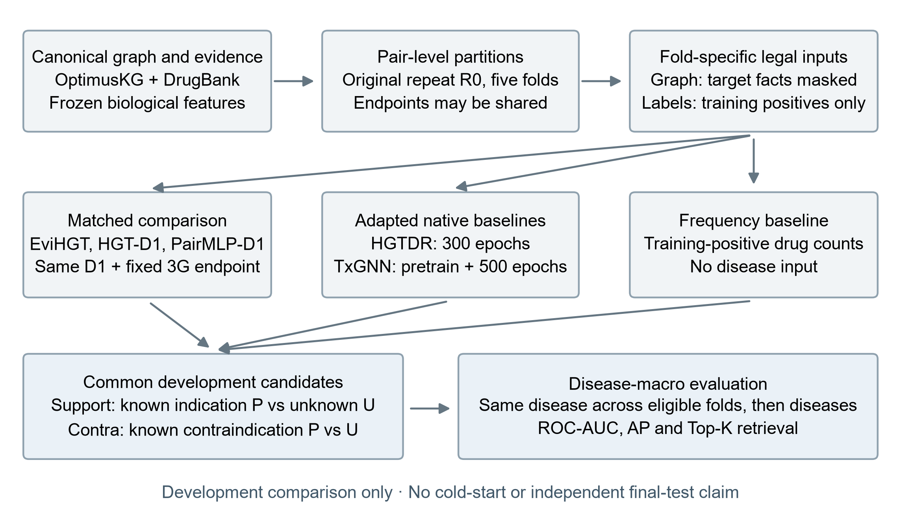
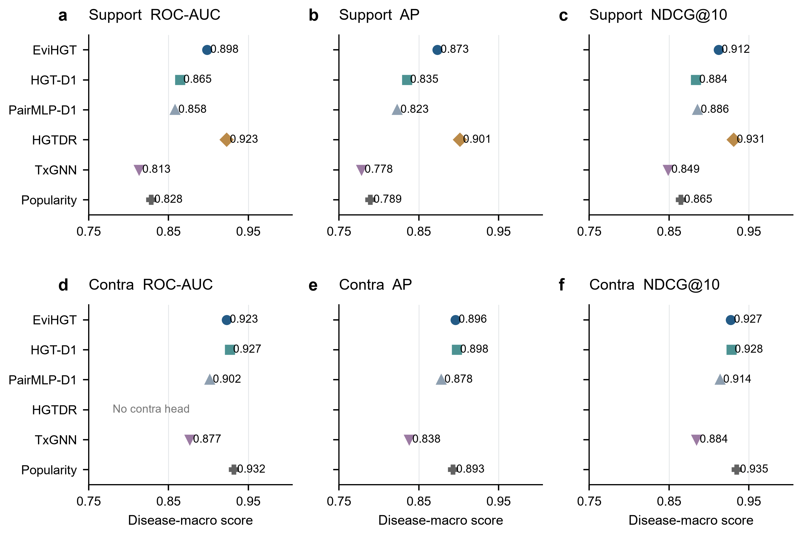
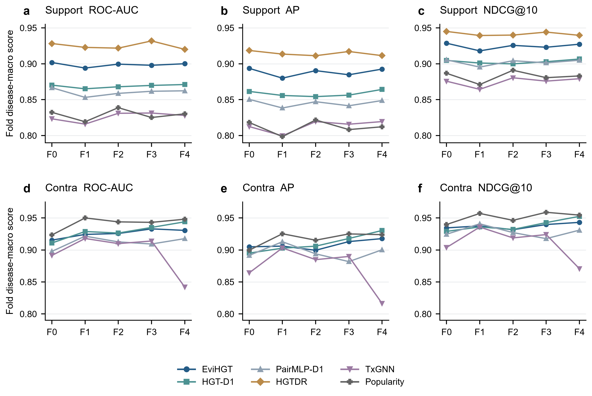
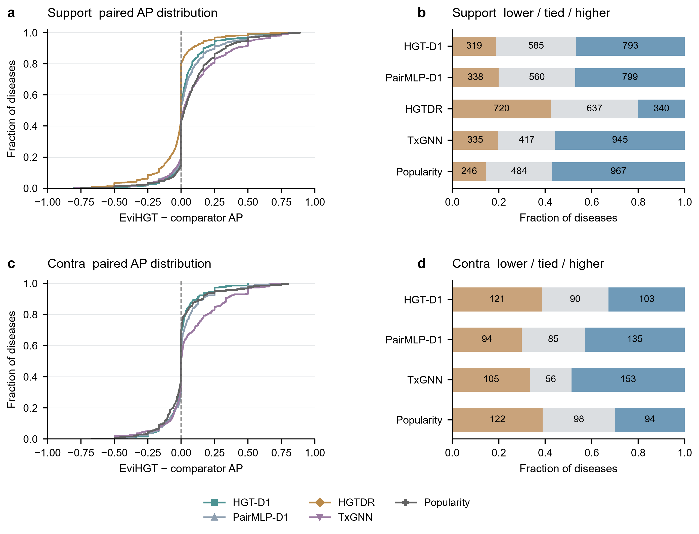
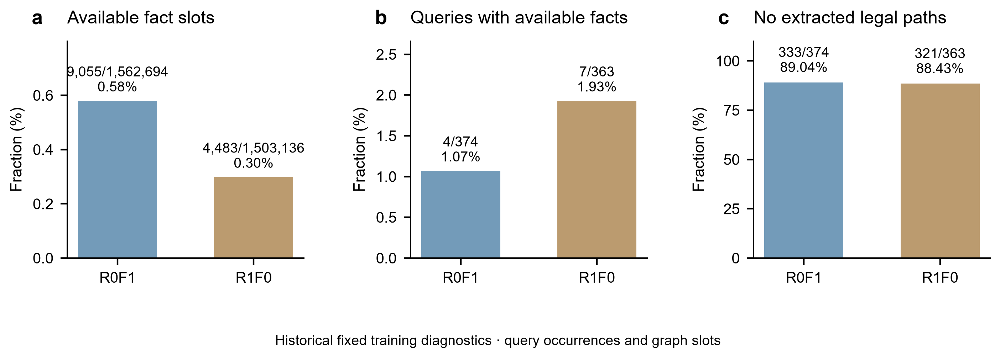
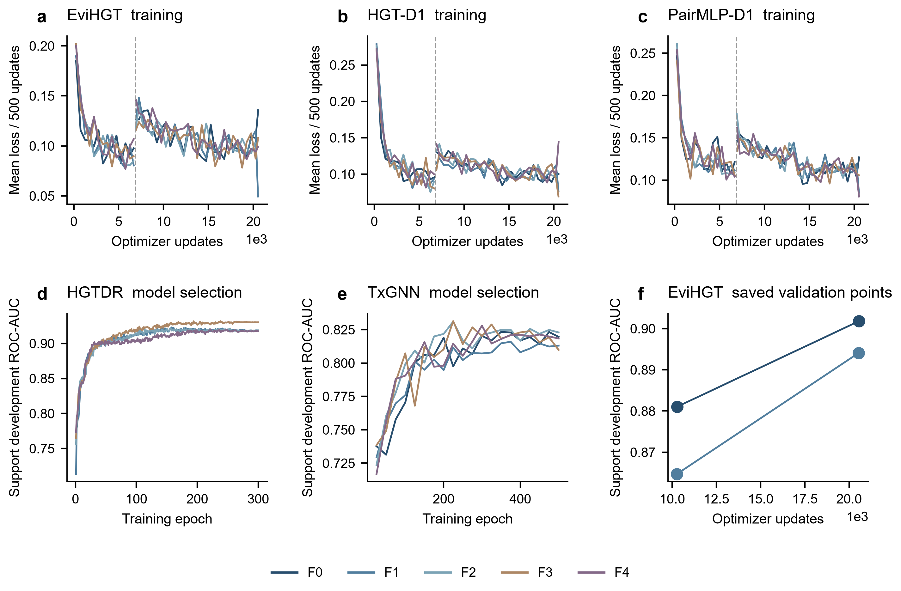

# Recorded development experiments

These figures summarize development runs recorded with the original research implementation. The repository includes aggregate statistics. Datasets, pair-level predictions and checkpoints remain local.

The main comparison measures ranking of observed positives against unlabeled candidates on development panels from five overlapping folds of repeat R0.

## Implemented development protocol

The development protocol uses pair-level splits, removes evaluation targets from graph and training inputs, and scores the support and contra channels separately.

[SVG](figures/experiments/fig01_evaluation_protocol.svg) · [PDF](figures/experiments/fig01_evaluation_protocol.pdf) · [PNG](figures/experiments/fig01_evaluation_protocol.png)

## Six-method comparison

For R0's five development folds, metrics are averaged across eligible folds within each disease, then across diseases. Support includes 1,697 diseases; contra includes 314. The plot shows point estimates. HGTDR contributes support results. The adapted methods follow their respective model-selection procedures.

[SVG](figures/experiments/fig02_main_comparison.svg) · [PDF](figures/experiments/fig02_main_comparison.pdf) · [PNG](figures/experiments/fig02_main_comparison.png)

## Saved-prediction ROC and PR curves

The display uses interpolated, disease-macro-averaged curves for five neural methods, four with contra outputs. Use the main comparison for exact AP and results for Popularity, for which only aggregate scores were retained. U denotes unlabeled candidates.

[SVG](figures/experiments/fig03_development_curves.svg) · [PDF](figures/experiments/fig03_development_curves.pdf) · [PNG](figures/experiments/fig03_development_curves.png)

## Fold profiles

Each point is a disease-macro average within one R0 fold. The primary comparison averages within disease before pooling across diseases. Folds overlap.

[SVG](figures/experiments/fig04_fold_profiles.svg) · [PDF](figures/experiments/fig04_fold_profiles.pdf) · [PNG](figures/experiments/fig04_fold_profiles.png)

## Paired disease differences

The figure gives EviHGT AP minus comparator AP for each disease and counts lower, tied and higher values. The descriptive comparison covers all eligible diseases and uses a tie tolerance of `1e-12`.

[SVG](figures/experiments/fig05_disease_heterogeneity.svg) · [PDF](figures/experiments/fig05_disease_heterogeneity.pdf) · [PNG](figures/experiments/fig05_disease_heterogeneity.png)

## Candidate-size analysis

The post-hoc analysis groups disease-fold records by candidate count. A disease can enter more than one stratum across folds. Each stratum uses disease-first aggregation for all methods.

[SVG](figures/experiments/fig06_candidate_analysis.svg) · [PDF](figures/experiments/fig06_candidate_analysis.pdf) · [PNG](figures/experiments/fig06_candidate_analysis.png)

## Contra aggregation sensitivity

Contra AP ordering depends on whether averages are computed first by disease or by fold. The figure compares both summaries and shows the number of evaluable folds per disease.

[SVG](figures/experiments/fig07_aggregation_sensitivity.svg) · [PDF](figures/experiments/fig07_aggregation_sensitivity.pdf) · [PNG](figures/experiments/fig07_aggregation_sensitivity.png)

## Historical two-cell ablations

The figure shows all eight cell/intervention/head comparisons for R0F1 and R1F0 at their fixed 3G endpoints. `CONTENT_ZERO` removes explicit evidence and provenance content outputs. `FACT_QUALITY_CONSTANT` assigns uniform masses to available facts and preserves availability masks.

[SVG](figures/experiments/fig08_core_ablations.svg) · [PDF](figures/experiments/fig08_core_ablations.pdf) · [PNG](figures/experiments/fig08_core_ablations.png)

## Historical diagnostic exposure

The two training diagnostic panels each contain 64 positive groups. Fractions count query occurrences and graph slots, including repeats. Path coverage measures the paths found by the bounded extractor.

[SVG](figures/experiments/fig09_diagnostic_exposure.svg) · [PDF](figures/experiments/fig09_diagnostic_exposure.pdf) · [PNG](figures/experiments/fig09_diagnostic_exposure.png)

## Recorded optimization and selection

Matched-model curves summarize all 307,881 updates in contiguous bins of at most 500 updates, split at the sampling-stage boundary. They show combined two-head loss. Native curves show support development AUC. HGTDR includes recorded F1–F4 curves; EviHGT has validation observations only for F0/F1.

[SVG](figures/experiments/fig10_training_dynamics.svg) · [PDF](figures/experiments/fig10_training_dynamics.pdf) · [PNG](figures/experiments/fig10_training_dynamics.png)

## Recorded runtime windows

The figure separates baseline file-time windows from 12 EviHGT training and post-training windows. Timing definitions, hardware and run settings vary across methods. The [runtime reference](runtime_reference.json) records the instrumented optimizer-loop component times and the paths of the original research logs.

[SVG](figures/experiments/fig11_runtime.svg) · [PDF](figures/experiments/fig11_runtime.pdf) · [PNG](figures/experiments/fig11_runtime.png)
