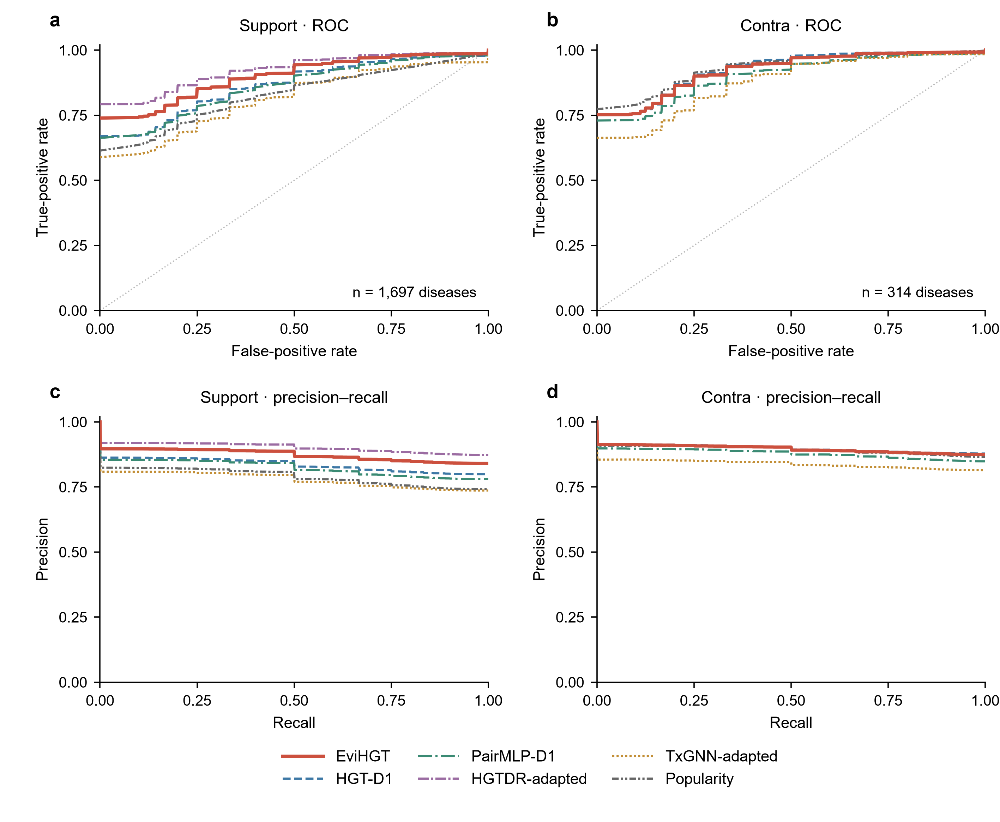
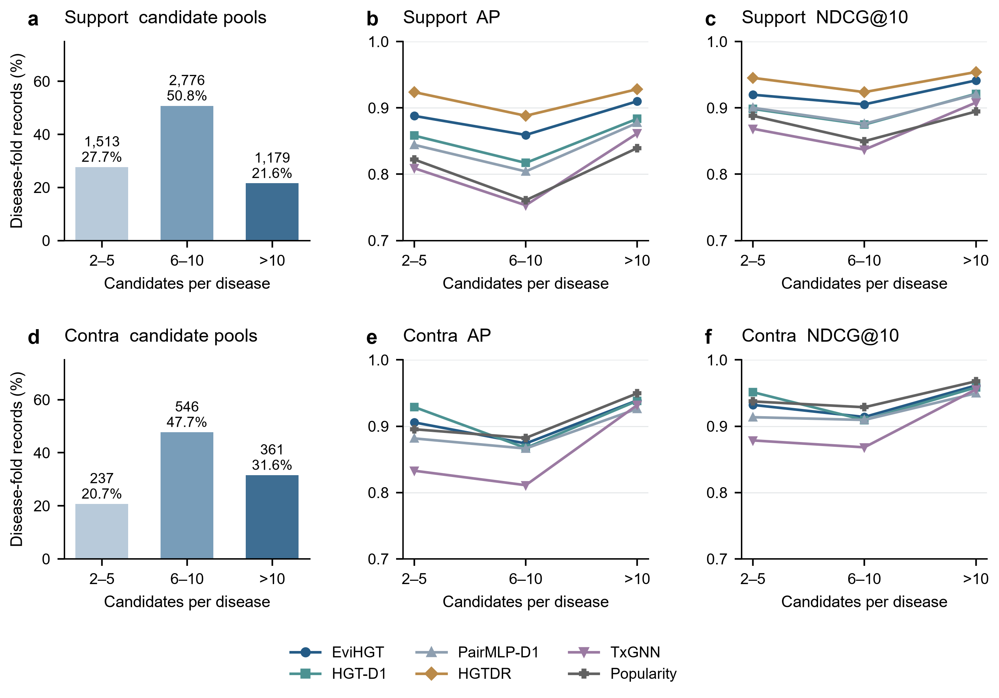
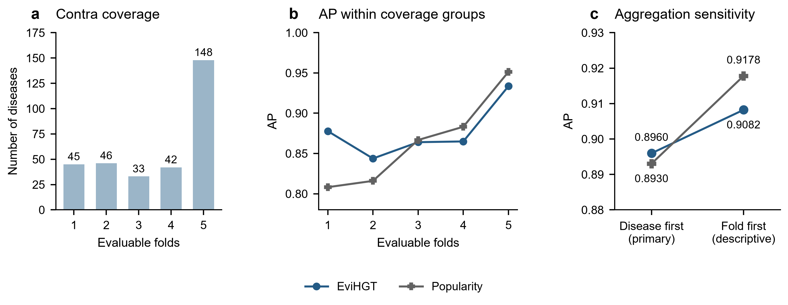
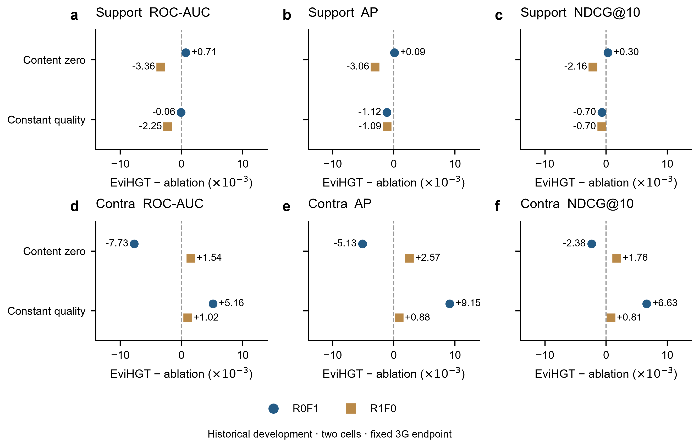
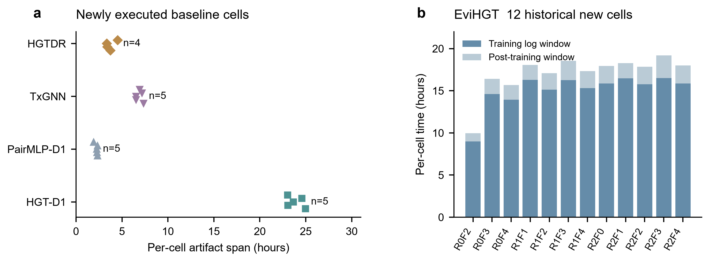
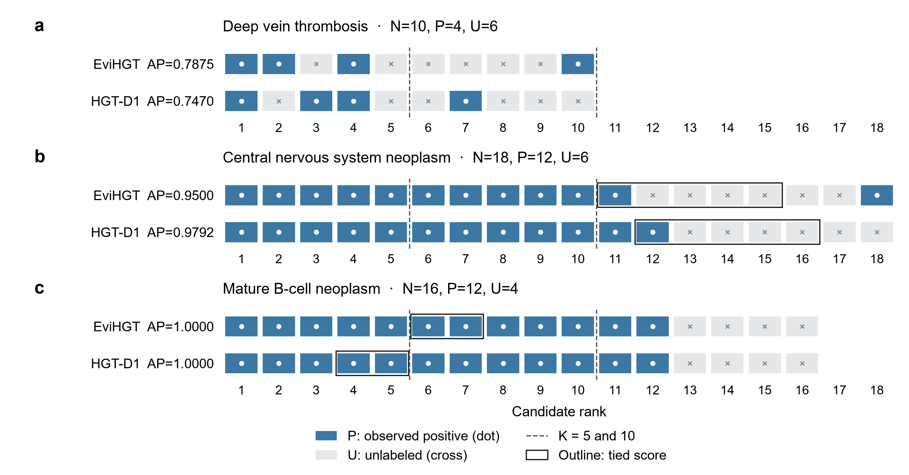
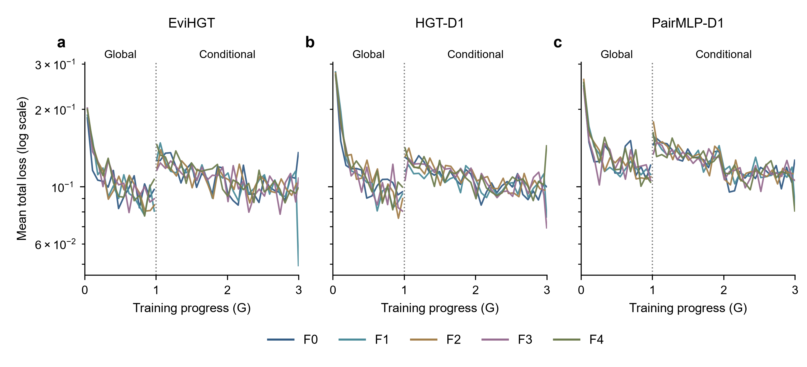
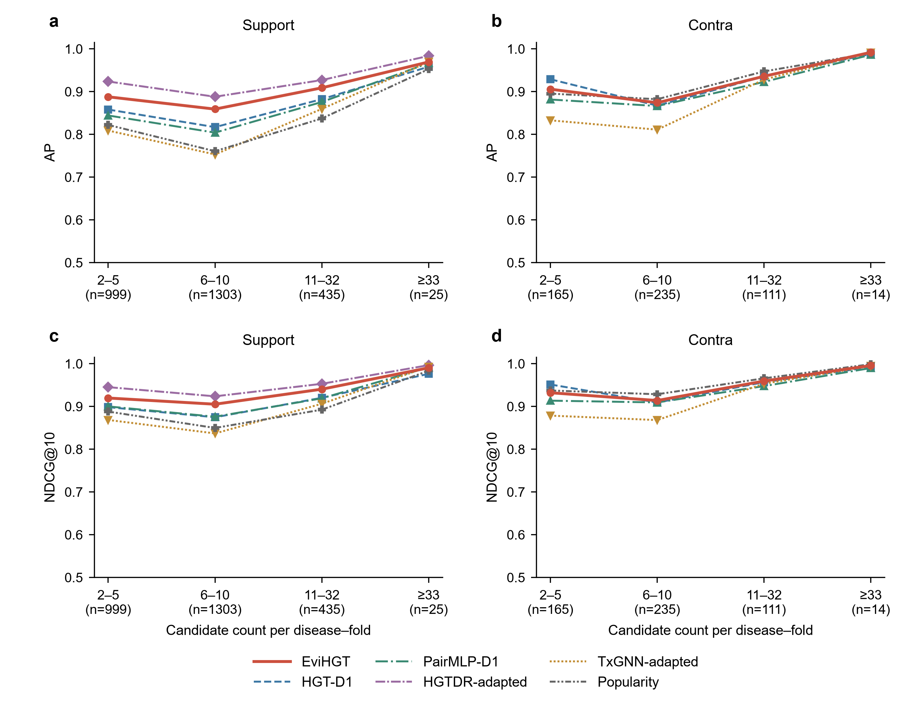
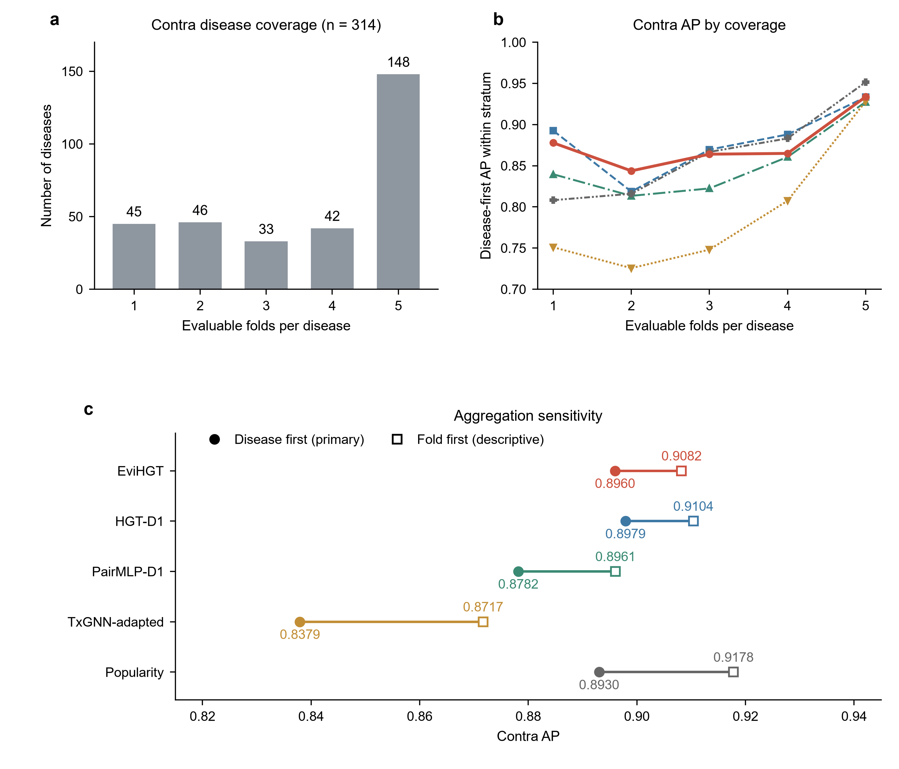
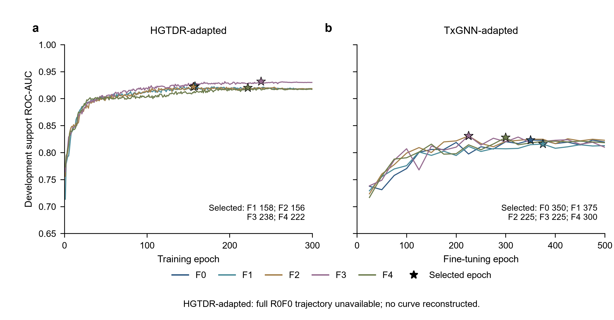

# Recorded development experiments

The [experiment source index](../experiments/) links each study to its implementation and the audit records for the common development panels.

The development figures summarize runs from the original research implementation. The historical sections cover an earlier holdout evaluation and its validation studies. The repository includes aggregate statistics. Datasets, pair-level predictions and checkpoints remain local.

The main comparison measures ranking of observed positives against unlabeled candidates on development panels from five overlapping folds of repeat R0.

The [HGTDR-adapted-contra implementation](../experiments/hgtdr_contra/) trains a separate model on recorded contraindications. The main comparison includes that model on the same contra candidates as the other methods. The saved-prediction and stratified figures show the original comparison set.

## Implemented development protocol

The development protocol uses pair-level splits, removes evaluation targets from graph and training inputs, and scores the support and contra channels separately.

[SVG](figures/experiments/fig01_evaluation_protocol.svg) · [PDF](figures/experiments/fig01_evaluation_protocol.pdf) · [PNG](figures/experiments/fig01_evaluation_protocol.png)

## Main development comparison

For R0's five inner development folds, metrics are averaged across eligible folds within each disease, then across diseases. Support covers 1,697 diseases and contra covers 314. HGTDR-adapted contributes support scores and HGTDR-adapted-contra contributes contra scores. Each single-output model selects its checkpoint on the corresponding development panel. EviHGT uses the fixed three-cycle endpoint. The [README table](../README.md#development-results) gives the exact scores.

[SVG](figures/experiments/fig02_main_comparison.svg) · [PDF](figures/experiments/fig02_main_comparison.pdf) · [PNG](figures/experiments/fig02_main_comparison.png)

## Saved-prediction ROC and PR curves

The curves average within each disease across eligible folds, then across diseases. They cover the six support methods and five contra methods in the original comparison. HGTDR-adapted contributes support curves. Popularity scores were reconstructed from training-positive counts in each channel. U denotes unlabeled candidates.

[SVG](figures/experiments/fig03_development_curves.svg) · [PDF](figures/experiments/fig03_development_curves.pdf) · [PNG](figures/experiments/fig03_development_curves.png)

## Fold profiles

Each point is a disease-macro average for one R0 fold in the original comparison. HGTDR-adapted appears in the support panels. The primary comparison averages within disease before pooling across the overlapping folds.

[SVG](figures/experiments/fig04_fold_profiles.svg) · [PDF](figures/experiments/fig04_fold_profiles.pdf) · [PNG](figures/experiments/fig04_fold_profiles.png)

## Paired disease differences

The figure gives EviHGT AP minus comparator AP for each disease and counts lower, tied and higher values. The descriptive comparison covers all eligible diseases and uses a tie tolerance of `1e-12`.

[SVG](figures/experiments/fig05_disease_heterogeneity.svg) · [PDF](figures/experiments/fig05_disease_heterogeneity.pdf) · [PNG](figures/experiments/fig05_disease_heterogeneity.png)

## Candidate-size analysis

The post-hoc analysis groups disease-fold records by candidate count. A disease can enter more than one stratum across folds. Each stratum uses disease-first aggregation for all methods.

[SVG](figures/experiments/fig06_candidate_analysis.svg) · [PDF](figures/experiments/fig06_candidate_analysis.pdf) · [PNG](figures/experiments/fig06_candidate_analysis.png)

## Contra aggregation sensitivity

Contra AP ordering depends on whether averages are computed first by disease or by fold. The figure compares both summaries and shows the number of evaluable folds per disease.

[SVG](figures/experiments/fig07_aggregation_sensitivity.svg) · [PDF](figures/experiments/fig07_aggregation_sensitivity.pdf) · [PNG](figures/experiments/fig07_aggregation_sensitivity.png)

## Historical two-cell ablations

The figure shows all eight cell/intervention/head comparisons for R0F1 and R1F0 at their fixed 3G endpoints. `CONTENT_ZERO` removes explicit evidence and provenance content outputs. `FACT_QUALITY_CONSTANT` assigns uniform masses to available facts and preserves availability masks.

[SVG](figures/experiments/fig08_core_ablations.svg) · [PDF](figures/experiments/fig08_core_ablations.pdf) · [PNG](figures/experiments/fig08_core_ablations.png)

## Historical diagnostic exposure

The two training diagnostic panels each contain 64 positive groups. Fractions count query occurrences and graph slots, including repeats. Path coverage measures the paths found by the bounded extractor.

[SVG](figures/experiments/fig09_diagnostic_exposure.svg) · [PDF](figures/experiments/fig09_diagnostic_exposure.pdf) · [PNG](figures/experiments/fig09_diagnostic_exposure.png)

## Recorded optimization and selection

Matched-model curves summarize all 307,881 updates in contiguous bins of at most 500 updates, split at the sampling-stage boundary. They show combined two-head loss. Native curves show support development AUC. HGTDR includes recorded F1–F4 curves; EviHGT has validation observations only for F0/F1.

[SVG](figures/experiments/fig10_training_dynamics.svg) · [PDF](figures/experiments/fig10_training_dynamics.pdf) · [PNG](figures/experiments/fig10_training_dynamics.png)

## Recorded runtime windows

The figure separates baseline file-time windows from 12 EviHGT training and post-training windows. Timing definitions, hardware and run settings vary across methods. The [runtime reference](runtime_reference.json) records the instrumented optimizer-loop component times and the relative paths and SHA-256 checksums of the original research logs.

[SVG](figures/experiments/fig11_runtime.svg) · [PDF](figures/experiments/fig11_runtime.pdf) · [PNG](figures/experiments/fig11_runtime.png)

## Case rankings

Rank positions of observed positives (P) and unlabeled candidates (U) for three R0F0 support panels. The examples show a gain, a loss and a tie in AP for EviHGT versus HGT-D1. Outlines mark tied scores.

[SVG](figures/experiments/fig12_case_rankings.svg) · [PNG](figures/experiments/fig12_case_rankings.png)

## Training loss by sampling stage

Combined two-head loss for the 15 matched method and fold runs. Windows contain at most 500 updates. Each run is normalized by its own positive groups per cycle (G). The global stage spans 0–1G and the conditional stage spans 1–3G.

[SVG](figures/experiments/fig13_training_loss_by_stage.svg) · [PNG](figures/experiments/fig13_training_loss_by_stage.png)

## Candidate strata and disease counts

Support and contra AP and NDCG@10 for panels with 2–5, 6–10, 11–32 or at least 33 candidates. Each count gives the number of unique diseases in that stratum. Diseases can enter multiple strata across folds.

[SVG](figures/experiments/fig14_candidate_strata.svg) · [PNG](figures/experiments/fig14_candidate_strata.png)

## Contra AP aggregation across methods

Disease-first and fold-first contra AP for the five methods with contra scores. Coverage strata describe the 314 evaluable diseases.

[SVG](figures/experiments/fig15_aggregation_sensitivity_all_methods.svg) · [PNG](figures/experiments/fig15_aggregation_sensitivity_all_methods.png)

## Native model selection by fold

The 1,300 recorded support validation observations cover every HGTDR epoch in F1–F4 and every 25 TxGNN fine-tuning epochs in F0–F4. Markers identify the selected epochs. The full HGTDR F0 trajectory is unavailable.

[SVG](figures/experiments/fig16_native_selection_by_fold.svg) · [PNG](figures/experiments/fig16_native_selection_by_fold.png)

## Historical holdout evaluation

The six-variant holdout study evaluated an earlier EviHGT implementation trained with seed 42. Stage A compared six model configurations on shared support panels with up to 32 unlabeled candidates per disease. Of 1,354 diseases, 1,109 had observed positives and contributed to the metrics. Stage B evaluated the full model on six preselected diseases using all eligible drug candidates. The paired intervals describe variation over resampled diseases for the fixed runs.

The historical cold-drug and cold-disease panels used up to 64 unlabeled candidates per query and had 1,078 and 210 evaluable queries, respectively. Many queries had constant scores. Curve legends report mean query-wise ROC-AUC or AP. The plotted curves use interpolation on a common grid.

| Figure | Vector | Bitmap |
| --- | --- | --- |
| Stage A ROC curves | [SVG](figures/experiments/historical_holdout/01_stage_a_macro_roc.svg) | [PNG](figures/experiments/historical_holdout/01_stage_a_macro_roc.png) |
| Stage A PR curves | [SVG](figures/experiments/historical_holdout/02_stage_a_macro_pr.svg) | [PNG](figures/experiments/historical_holdout/02_stage_a_macro_pr.png) |
| Stage A ROC-AUC distributions | [SVG](figures/experiments/historical_holdout/03_stage_a_auc_distribution.svg) | [PNG](figures/experiments/historical_holdout/03_stage_a_auc_distribution.png) |
| Stage A AP distributions | [SVG](figures/experiments/historical_holdout/04_stage_a_ap_distribution.svg) | [PNG](figures/experiments/historical_holdout/04_stage_a_ap_distribution.png) |
| Stage A paired differences | [SVG](figures/experiments/historical_holdout/05_stage_a_paired_delta.svg) | [PNG](figures/experiments/historical_holdout/05_stage_a_paired_delta.png) |
| Stage A top-K ranking metrics | [SVG](figures/experiments/historical_holdout/06_stage_a_ranking_metrics.svg) | [PNG](figures/experiments/historical_holdout/06_stage_a_ranking_metrics.png) |
| Stage B full-candidate metrics by disease | [SVG](figures/experiments/historical_holdout/07_stage_b_per_disease_retrieval.svg) | [PNG](figures/experiments/historical_holdout/07_stage_b_per_disease_retrieval.png) |
| Stage B observed positives by rank | [SVG](figures/experiments/historical_holdout/08_stage_b_topk_summary.svg) | [PNG](figures/experiments/historical_holdout/08_stage_b_topk_summary.png) |
| Cold drug ROC curve | [SVG](figures/experiments/historical_holdout/09_cold_drug_macro_roc.svg) | [PNG](figures/experiments/historical_holdout/09_cold_drug_macro_roc.png) |
| Cold drug PR curve | [SVG](figures/experiments/historical_holdout/10_cold_drug_macro_pr.svg) | [PNG](figures/experiments/historical_holdout/10_cold_drug_macro_pr.png) |
| Cold disease ROC curve | [SVG](figures/experiments/historical_holdout/11_cold_disease_macro_roc.svg) | [PNG](figures/experiments/historical_holdout/11_cold_disease_macro_roc.png) |
| Cold disease PR curve | [SVG](figures/experiments/historical_holdout/12_cold_disease_macro_pr.svg) | [PNG](figures/experiments/historical_holdout/12_cold_disease_macro_pr.png) |
| Cold query metric distributions | [SVG](figures/experiments/historical_holdout/13_cold_metric_distributions.svg) | [PNG](figures/experiments/historical_holdout/13_cold_metric_distributions.png) |

## Historical validation and learning-rate tuning

The earlier learning-rate study compared five completed settings over two validation cycles with seed 42 and selected 5e-5. The variant comparison shows the deterministic validation objective used for checkpoint selection in the same experimental phase. The later inner-validation panels compare the selected and endpoint checkpoints for development fold 0. They show mean ROC and PR curves with disease percentile bands and observed-positive versus unlabeled counts at a fixed raw-logit threshold of zero.

| Figure | Vector | Bitmap |
| --- | --- | --- |
| Best validation objective per learning rate | [PDF](figures/experiments/historical_tuning/lr_tuning_best_objective.pdf) | [PNG](figures/experiments/historical_tuning/lr_tuning_best_objective.png) |
| Validation objective by cycle and learning rate | [PDF](figures/experiments/historical_tuning/lr_tuning_cycle_objectives.pdf) | [PNG](figures/experiments/historical_tuning/lr_tuning_cycle_objectives.png) |
| Validation objective across model variants | [PDF](figures/experiments/historical_tuning/validation_objective_comparison.pdf) | [PNG](figures/experiments/historical_tuning/validation_objective_comparison.png) |
| Inner validation at the selected checkpoint | [SVG](figures/experiments/historical_tuning/inner_diagnostics_metric_selected.svg) | [PNG](figures/experiments/historical_tuning/inner_diagnostics_metric_selected.png) |
| Inner validation at the endpoint checkpoint | [SVG](figures/experiments/historical_tuning/inner_diagnostics_endpoint.svg) | [PNG](figures/experiments/historical_tuning/inner_diagnostics_endpoint.png) |
